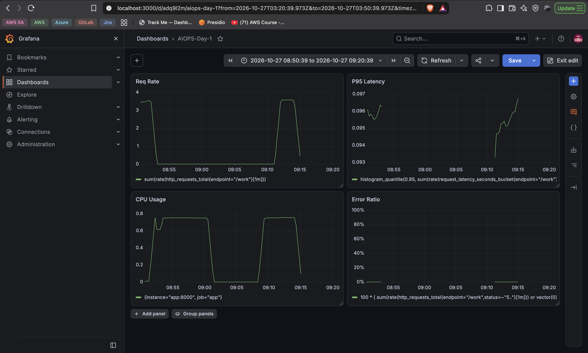

# Day 1 — Mystery Challenge: Problem Statement

---

**It's 7:45 PM, dinner rush.**

Support has just escalated a complaint: customers are posting on social media that checkout on the food-delivery app is "acting up." That is the entire alert. No dashboard link, no error code, no timestamp.

**You are the on-call engineer.**

Using only your `AIOps Day 1` dashboard and the Prometheus and Loki queries you already know, you have **8 minutes** to tell your team three things:

1. What is actually happening to users right now?
2. What do you believe is causing it, and what specific evidence makes you say that?
3. Is this burning your error budget — the SLO you wrote earlier today?

**Rules:**
- No runbook. You will not be given one, and looking one up is against the spirit of the exercise.
- No asking anyone what's wrong. The system is the only thing you get to interrogate.
- No guessing. Every claim you make must point at a number or a log line you actually saw.

---

### How to run it

```
python3 day1_mystery_challenge.py
```

Nothing to set up beforehand — it picks a fault at random, right there on your own laptop. Investigate for the time shown. The fault clears itself automatically when time is up — there is no command that reveals the answer to you. At the end, the script asks you to type your diagnosis (the three answers above) and saves it to a file.

**Submit that saved file to your trainer as-is.** It records the real answer too, but only *after* your diagnosis is already locked in, together with a verification hash — so don't edit it after the fact, your trainer can tell.


## Solution 

```
{
  "signal_changed": "CPU usage",
  "log_evidence": "The logs showed successful /work requests with HTTP status 200",
  "diagnosis": "I believe the problem is excessive CPU consumption because CPU usage increased while the error ratio remained at 0% and P95 latency stayed around 95 milliseconds.",
  "slo_impact": "This does not burn the availability/error budget because the error ratio is 0%. It may affect the latency budget only if the SLO threshold is below 95 milliseconds.",
  "timestamp": 1793072890,
  "actual_fault": "cpu",
  "integrity_hash": "60c02ddb63f2c2172a8319c90f203b9b1492b78848ed403a53432d53e54f7bfb"
}
```